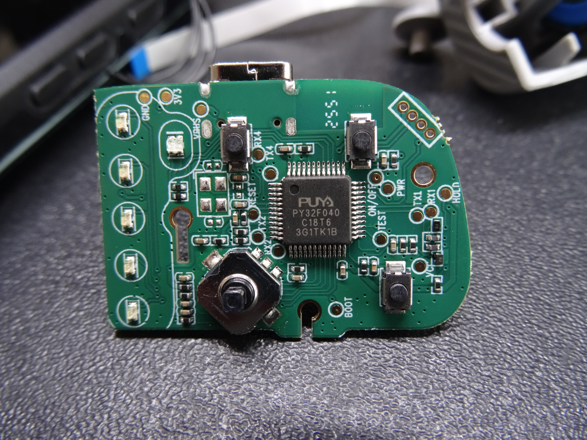
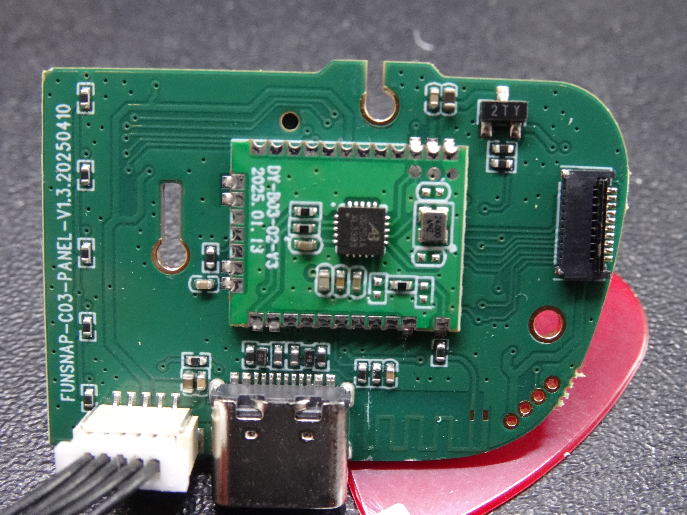
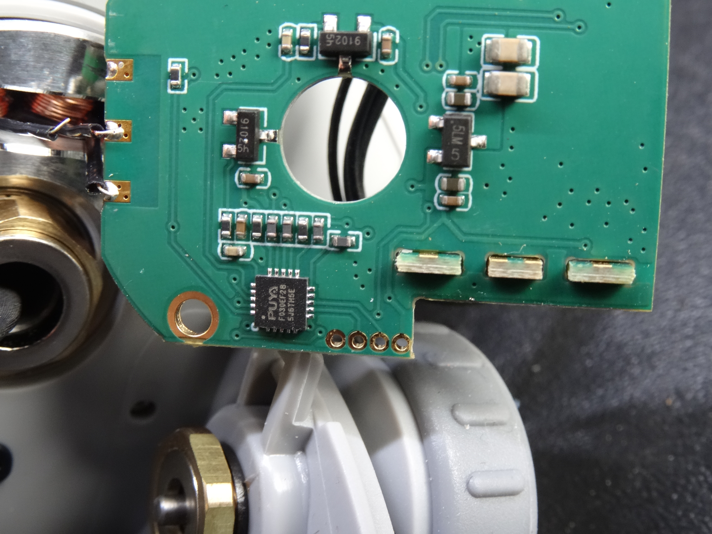

# Funsnap CM8 firmware and hardware reverse engineering

Research archive for the **Funsnap CM8 smartphone gimbal**, its **Capture 2 Android app**, bundled firmware, PCB revisions, UART communication and SWD readout protection. The investigation started with a tilt/pitch control issue and explored how the installed firmware could be recovered or modified.

The archive preserves owner photographs, FCC exhibits, Puya IC documentation, APK disassembly, original update assets and oscilloscope captures so another researcher can continue from the evidence. Research was carried out on 9–10 November 2026 and assembled here on 11 November 2026.

**Current result** — Capture 2's CM8 update path and two bundled firmware images were identified. SWD communication with an attached Cortex-M0+ succeeded, and its option bytes indicated RDP level 1. The installed firmware was not recovered. The tilt issue remains unresolved, and a custom firmware upload has not been demonstrated. [Research log](docs/research-log.md) · [SWD output](measurements/swd/openocd-success.txt)

## Contents

- [Observed problem and device versions](#observed-problem-and-device-versions)
- [Capture 2 firmware findings](#capture-2-firmware-findings)
- [Hardware and photographs](#hardware-and-photographs)
- [SWD and readout protection](#swd-and-readout-protection)
- [Related models and FCC evidence](#related-models-and-fcc-evidence)
- [Work completed and open questions](#work-completed-and-open-questions)
- [Continue the investigation](#continue-the-investigation)
- [Files and sources](#files-and-sources)

## Observed problem and device versions

The owner reported that, when the grip is tilted forward from upright toward horizontal, the camera starts pointing downward and upward joystick input stops recovering the intended view. The behavior occurs in both PF and L modes at approximately the same grip orientation, with mechanical travel still available. The angle was estimated visually and was never measured. A particular numeric angle should therefore not be used as an established reproduction condition.

The intended behavior is to retain the camera's viewing direction while tilting the grip and preserve upward and downward joystick adjustment. A firmware limit is one hypothesis. The cause has not been isolated to a specific controller, function or axis feedback mechanism.

| Version display on the examined CM8 | Reported value | Interpretation |
| --- | --- | --- |
| Gimbal Version | `1.10.9` | The app formats this as fixed text `1.` followed by F01 version `10` and F04 version `9` |
| Bluetooth Version | `260507` | Separate Bluetooth version field. Its encoding and matching image are unresolved |

The version formatting and update comparison were traced in the app. The installed F01/F04 bytes have not been dumped. The app's component labels do not establish which physical MCU runs each installed component. [App analysis](docs/capture2-app.md) · [APK method extracts](analysis/apk/fullmethods.txt)

## Capture 2 firmware findings

Android package **`com.dy.capture.google`**, Capture 2 **2.6.74**, contains firmware under `assets/firmware/`. Capture 2 **2.6.73** was also checked. Both sampled APKs contain byte-identical CM8 C4 files. APK hashes and a complete firmware asset inventory are archived for reproducibility. [APK hashes](analysis/apk/apk-hashes.json) · [Asset inventory](analysis/apk/firmware-inventory.json)

The two exact APK samples are preserved as release attachments. [Download the research source APKs](https://github.com/dixi83/Funsnap_CM8_Firmware/releases/tag/research-archive-2026-11-11)

| CM8 update asset | Wrapped file size | Header and trailer | Payload reset vector | Binary analysis |
| --- | --- | --- | --- | --- |
| `C4_F01.bin` | 100,542 bytes | `C4 F1 08` | `0x08003145` | Cortex-M4/FPU code, strong PY32F403 family candidate |
| `C4_F04.bin` | 32,218 bytes | `C4 F4 07` | `0x080030D9` | Cortex-M0+ code, strong PY32F040 family candidate |

Both payloads fit an application load address of **`0x08003000`**, after removing three bytes at each end. The MCU families are inferred from executable instructions, interrupt layout and peripheral addresses. The visible panel MCU is a PY32F040, but the F01 target MCU has not been physically identified. The motor board photographed below carries an F030-family MCU, which cannot execute the archived M4/FPU F01 image. [Firmware analysis](docs/firmware-analysis.md) · [Original assets](firmware/capture2-2.6.74)

The examined app routes **CM8 device type `3` to `C04` / `C4`**. Capture π uses `C3`, while CM9 has a separate `C09` route. Both examined CM8 PCBs have `C03` silkscreen. This establishes a difference between PCB markings and app firmware selection. Firmware compatibility cannot be inferred from the board marking alone. [Selection code](analysis/apk/fullmethods.txt) · [Asset initialization](analysis/apk/assetsinit.txt)

The owner's F01 `10` and F04 `9` are newer than bundled versions `8` and `7`. This explains the absence of an offered upgrade through the analyzed version check. Raising the app's stored offered version was discussed as a way to expose the update UI, but that experiment was not carried out. A changed version number would still leave the old executable code in the file. [App analysis](docs/capture2-app.md)

The updater strips the six wrapper bytes, pads the payload with `FF` to a multiple of **1,024 bytes**, and calculates **CRC-32 per block and over the padded payload**. The inspected sending path contains no observed firmware signing operation. Device-side authentication, model checks, downgrade handling and recovery behavior remain unknown. [Updater disassembly](analysis/apk/ota-methods.txt) · [Transport disassembly](analysis/apk/ota-transport.txt)

## Hardware and photographs

The owner's unit differs from the early CM8 FCC photographs, particularly in the Bluetooth module. Identify a board revision before transferring conclusions between units.

| Board or module | Observed marking | Evidence and confidence |
| --- | --- | --- |
| Button/control panel | `FUNSNAP-C03-PANEL-V1.3.20250410` | Owner photograph |
| Panel MCU | `PUYA PY32F040 C18T6` | Readable marking, consistent with PY32F040C18T6 in LQFP48 |
| Panel Bluetooth module | `DY-B03-02-V3`, dated `2025.01.13` | Module marking visible. Exact radio silicon remains unresolved |
| Motor/axis board | `C03-C-V1.1.20241115` | Owner photograph |
| Motor/axis MCU | `PUYA F030EF28` | Readable short marking. PY32F030F28U7-E / QFN20 pinout is the working identification |
| Earlier FCC Bluetooth hardware | Barrot `BR8051A01` | Identification from the earlier filing photographs, specific to that sample |

### Panel MCU and controls

### Panel rear and Bluetooth module

### Motor MCU

All six original photographs and two annotated SWD images are included. The gallery links the overview and connector-side views and records the original filenames. [Photo gallery](photos/README.md) · [Hardware and pinouts](docs/hardware.md)

The owner traced the connection between the two visible controllers to the pair labelled **UART1**, with VCC and GND as the other connections between those boards. Both boards expose four edge pads connected to GND, 3V3 and the MCU's two SWD-capable pins. The factory/UART interpretation of those edge pads was an early hypothesis. Continuity measurements and subsequent SWD communication established the debug connection. [Hardware measurements](docs/hardware.md)

| Signal | Panel PY32F040 LQFP48 | Motor PY32F030 QFN20 pinout 2 |
| --- | --- | --- |
| SWDIO / PA13 | Pin `34` | Pin `7` |
| SWCLK / PA14 | Pin `37` | Pin `8` |
| GND and 3V3 | Outer edge pads | Outer edge pads |

Use the annotated photographs for orientation. The four-pad order differs between boards. Pin functions beyond these measured connections are documented separately with the matching datasheet figures. [Panel annotated header](photos/pinouts/panel-swd-annotated.png) · [Motor annotated header](photos/pinouts/motor-swd-annotated.png)

## SWD and readout protection

An ESP-Prog/FT2232H attempt was followed by ST-Link V2 tests using OpenOCD. Windows driver setup, power problems and a loose SWCLK wire complicated the earlier attempts. The board rail initially measured about `1.2 V` in the attempted probe-powered setup and later measured `3.3 V` using the device's normal power arrangement.

Two PicoScope CSV captures preserve unsuccessful connection attempts. The first captured only the initial high-data clocks. The second was decoded during the investigation as containing four `0xA5` DPIDR read requests with `000` response bits, without a valid ACK. These captures precede the successful connection and do not demonstrate flash protection. [Measurement notes and raw files](measurements/swd/README.md)

A later ST-Link connection at **100 kHz** returned these values.

| Item | Result |
| --- | --- |
| SWD DPIDR | `0x0BC11477` |
| CPUID at `0xE000ED00` | `0x410CC601`, identified as Cortex-M0+ r0p1 |
| RAM and system memory | Sample reads succeeded |
| Main flash `0x08000000` | Read failed |
| Application area `0x08003000` | Read failed |
| Zero alias `0x00000000` | Read failed |
| FLASH_OPTR at `0x40022020` | `0x0000D800` |
| Stored option word at `0x1FFF3100` | `0x27FFD800` |
| RDP byte | `0x00`, interpreted as level 1 under the Puya protection scheme |

The successful logs establish this result for **the attached M0+ device**. The session did not retain an unambiguous board identity for that final connection, so the result should not be generalized to every MCU in a CM8. No successful flash dump, firmware write, option-byte unlock or mass erase was performed. [Original OpenOCD output](measurements/swd/openocd-success.txt)

Puya documents a main-flash mass erase when RDP is normally changed from level 1 to level 0. The chip's own application can still use supported in-application programming operations. This leaves a possible vendor updater path, whose actual behavior must be established on the relevant component. Voltage glitching was researched but never attempted on the CM8. Published STM32 results provide background, while a corresponding Puya bypass remains unverified in this investigation. [Debugging and RDP notes](docs/debugging.md)

## Related models and FCC evidence

The CM8 filing is **FCC ID `2APVH-CM8`**, submitted by Shenzhen Funsnap Technology. Local copies preserve internal photographs, the manufacturer's model-difference declaration and a BLE test report. [FCC document index](documents/README.md) · [Filing page](https://fccid.io/2APVH-CM8)

| Model or name | Finding | Limit of the evidence |
| --- | --- | --- |
| VEVOR CM8 | VEVOR markets a CM8 and its manual identifies Funsnap as manufacturer | Exact owner-unit PCB revision has not been compared |
| Gadnic GIM00013 | Manual uses `CM8-XXXX` Bluetooth naming and Capture 2 | Likely rebrand, PCB identity remains unconfirmed |
| CM8S, CM8 Pro, CM8 Plus, CM6, CM7 and CM9 in the early CM8 declaration | Manufacturer declares the same PCB, circuit and internal structure for that filing's model list | Declaration applies to the represented filing samples |
| Later CM9 with FCC ID `2APVH-CM9` | Separate filing and changed hardware provide useful comparison images | The early declaration does not establish interchangeability with later CM9 hardware |

The `DY-B03-02-V3` designation appears on both the owner's CM8 module and the later CM9 photographs. Module reuse supports a comparison of that module. It does not establish complete board or firmware compatibility. [Model comparison and source links](docs/related-models.md)

## Work completed and open questions

| Investigation | Outcome |
| --- | --- |
| Search for independent CM8 replacement firmware | No independently verified replacement project was found during the search |
| Capture 2 APK analysis | CM8 model routing, versions, bundled binaries and updater behavior traced |
| Offline ARM analysis | Payload layout, probable MCU families and candidate angle/communication routines identified |
| Teardown photographs and continuity | Two board revisions, two visible Puya MCUs, UART1 and SWD pad connections recorded |
| ESP-Prog and ST-Link connection tests | ST-Link eventually established SWD communication |
| Flash readout | Blocked on the attached M0+ device, option values consistent with RDP1 |
| Firmware F01 v10 / F04 v9 recovery | Unresolved |
| Internal UART1 protocol and tilt capture | Proposed, capture and decoding remain outstanding |
| Modified APK, firmware patch or custom upload | Discussed, execution and device acceptance remain untested |
| Call-home/network investigation | Static URL strings archived. Runtime destinations and transmitted data remain unmeasured |
| Voltage glitching | Literature review only |

The initial angle search found float constants corresponding to ±25° in archived F01 v8 and a closely matching routine in C9_F01. The axis and purpose are unknown. Those constants do not establish the CM8's actual tilt limit. Details, addresses and disassembly are preserved as a candidate lead. [Firmware analysis](docs/firmware-analysis.md)

The related [CM8_Action_Gateway](https://github.com/dixi83/CM8_Action_Gateway) project is by the same owner and implements an external ESP32 BLE gateway. It provides useful CM8 communication context. It does not supply a replacement image for the controllers studied here.

## Continue the investigation

1. Establish the physical MCU/component mapping for the installed firmware. Record board revision, full chip markings, connector direction and the exact target of each debug connection.
2. Obtain the actual installed F01 v10 and F04 v9, or matching service images, and compare them with the archived versions. Preserve the bootloader and calibration areas if full readout becomes possible.
3. Passively capture both UART1 directions during boot, a version query and the reported tilt behavior. Record the baud rate, pin-to-pin routing, mode and joystick action alongside the raw capture.
4. Trace joystick input, stabilization correction and outgoing commands through the relevant firmware. Determine where commanded motion ceases to change before attributing the behavior to a particular limit.
5. Reconstruct the vendor update transaction and device validation. Establish a recovery route before testing a modified image.

The photographed motor PCB cannot be removed again on this unit without risking physical damage. Existing photographs and accessible panel/connector points are the available basis for follow-up measurements. [Open questions and continuation notes](docs/research-log.md#continuation)

For offline work, Python tools extract the firmware assets from an APK and inspect wrapper bytes, vectors, CRCs and the compared C4/C9 region. The archived binaries can also be imported into Ghidra at the documented payload address. [Tools and reproduction](tools/README.md)

## Files and sources

| Directory | Contents |
| --- | --- |
| [`docs/`](docs) | Detailed hardware, app, firmware, debugging and research notes |
| [`photos/`](photos/README.md) | Six original owner photographs and annotated SWD images |
| [`documents/`](documents/README.md) | FCC exhibits, Puya datasheets/reference manuals and model comparison documents |
| [`firmware/`](firmware/README.md) | Unmodified C3, C4 and C9 APK update assets with provenance |
| [`analysis/`](analysis) | APK disassembly, asset inventory, hashes, static URL strings and firmware analysis output |
| [`measurements/`](measurements/swd/README.md) | PicoScope CSV/PSDATA files, screenshots and successful OpenOCD logs |
| [`tools/`](tools/README.md) | Offline extraction and inspection scripts, plus the SWD identification configuration |
| [`sources.json`](sources.json) | Per-file origins, byte sizes and SHA-256 hashes for archived source material |

Evidence labels distinguish owner reports, physical observations, executable analysis and untested hypotheses. The archive summarizes the technical investigation and incorporates later corrections. Opinion, the raw private chat and unrelated local files are excluded from the research record. [Sources and evidence conventions](docs/sources.md)

Search terms include **Funsnap CM8 firmware**, **FunSnap CM8 reverse engineering**, **VEVOR CM8**, **Capture 2**, **com.dy.capture.google**, **C03**, **C04**, **C4_F01.bin**, **C4_F04.bin**, **PY32F040C18T6**, **F030EF28**, **PY32F030**, **PY32F403**, **tilt/pitch limit**, **SWD**, **UART**, **RDP** and **2APVH-CM8**.
