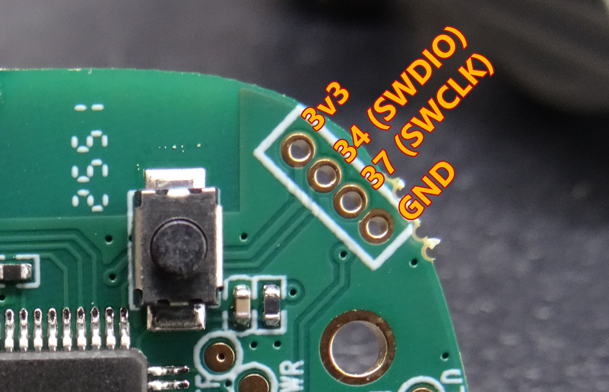
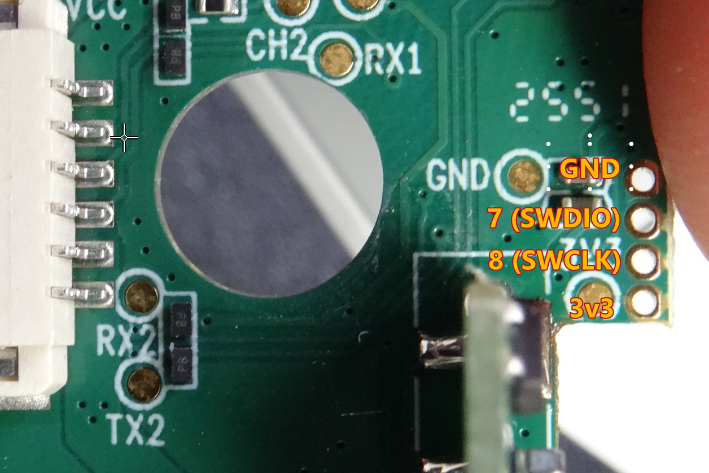

# CM8 hardware, MCU markings and test pads

## Examined unit

The owner supplied photographs of both sides of the panel and motor boards and measured continuity between the edge pads and MCU pins. Photographs capture one physical CM8 revision. The earlier FCC sample has different Bluetooth hardware. [Owner gallery](../photos/README.md) · [FCC internal photographs](../documents/fcc/CM8-internal-photos-8078955.pdf)

| Item | Recorded value | Evidence |
| --- | --- | --- |
| Panel PCB | `FUNSNAP-C03-PANEL-V1.3.20250410` | Rear photograph |
| Panel MCU | `PUYA PY32F040 C18T6`, lower marking `3G1TK1B` | Front photograph |
| Bluetooth daughterboard | `DY-B03-02-V3`, `2025.01.13` | Rear photograph |
| Motor PCB | `C03-C-V1.1.20241115` | Connector-side photograph |
| Motor MCU | `PUYA F030EF28` | Close-up photograph |

The panel marking corresponds to PY32F040C18T6, with a Cortex-M0+ in LQFP48. The motor short marking is consistent with the PY32F030F28U7-E family and QFN20 pinout 2. The full motor ordering code remains a working identification because the package carries an abbreviated marking. The F030 family has up to 64 KiB flash and uses a Cortex-M0+. [F040 datasheet](../documents/ic/PY32F040-datasheet.pdf#page=24) · [F030 datasheet](../documents/ic/PY32F030-datasheet.pdf#page=30)

## Signal connections established during the investigation

The owner traced one bidirectional serial pair between the two visible controllers, described as UART1, along with VCC and GND. Exact MCU UART pin routing, baud rate and message framing were not retained as measurements. Board labels `TX1/RX1` and `TX2/RX2` identify candidate test points, but peripheral numbering should be confirmed against chip pins and alternate functions.

The edge headers were initially considered possible factory UART interfaces. Final continuity measurements established these connections.

| Board | Physical order in the annotated photograph | MCU signal pins |
| --- | --- | --- |
| Panel, upper left to lower right | `3V3`, `SWDIO`, `SWCLK`, `GND` | `34`, `37` for the middle pair |
| Motor, top to bottom | `GND`, `SWDIO`, `SWCLK`, `3V3` | `7`, `8` for the middle pair |

The panel's initially reported pins 25/22 were corrected to **34/37**. The corrected values are used throughout this archive. SWD-capable pads can also have alternate peripheral functions, and successful SWD communication applies to the attached target at the time of the successful test. [Panel annotation](../photos/pinouts/panel-swd-annotated.png) · [Motor annotation](../photos/pinouts/motor-swd-annotated.png) · [Debug logs](../measurements/swd/openocd-success.txt)

## Pin references

The following pins come from the package drawings used during the investigation. The SWD connections to the edge headers were checked by continuity. Other rows are datasheet references that still require board routing checks.

| Function | Panel PY32F040C1xTx, LQFP48 | Motor PY32F030F2xUx(-E), QFN20 pinout 2 |
| --- | --- | --- |
| SWDIO / PA13 | 34 | 7 |
| SWCLK / PA14 | 37 | 8 |
| VSS | 23, 47 | 4 and exposed pad |
| VCC | 24, 48 | 6 |
| NRST / PF2 | 7 | 15 |
| BOOT0 | 44 / PF8 | 12 / PF4 |
| PA2, PA3 serial-function candidates | 12, 13 | 18, 19 |
| PA9, PA10 serial-function candidates | 30, 31 | Package-dependent, consult pin table |

Check the top-view pin-1 marker and the exact package variant before using a drawing. The panel RESET pad was reported too small for the owner to attach a wire, and a target NRST connection was not established. [F040 figure 3-3, PDF page 24](../documents/ic/PY32F040-datasheet.pdf#page=24) · [F030 figure 3-10, PDF page 30](../documents/ic/PY32F030-datasheet.pdf#page=30)

## Component mapping remains open

F04's archived binary matches the F040 family, making the panel a strong candidate target. F01's archived v8 binary contains M4/FPU code and is larger than the photographed F030's flash capacity. The original hypothesis that F01 belongs to a PY32F403 comes from the binary, and no photographed chip confirms it. The topology should be established before choosing a readout or patch target. Architecture and component mapping on the installed newer firmware remain open questions. [Firmware analysis](firmware-analysis.md)

The vertical daughterboard on the motor connector-side photograph and any other controllers or sensor boards remain incompletely documented. The exact radio IC, IMU, motor driver and angle sensor identities are unresolved. The owner cannot remove the motor board again without risking damage, so later work should use these photographs and accessible connector/test points.
