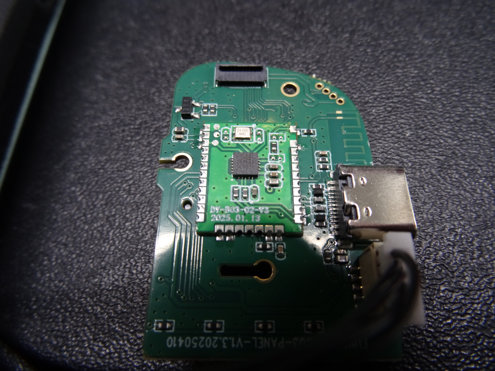
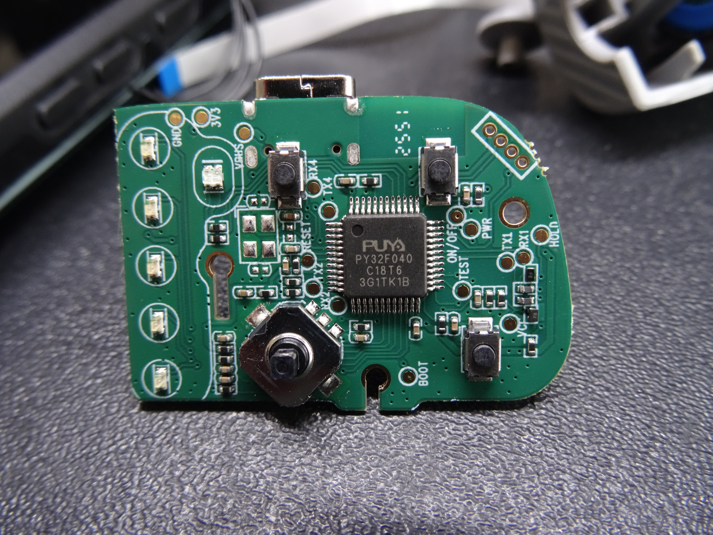
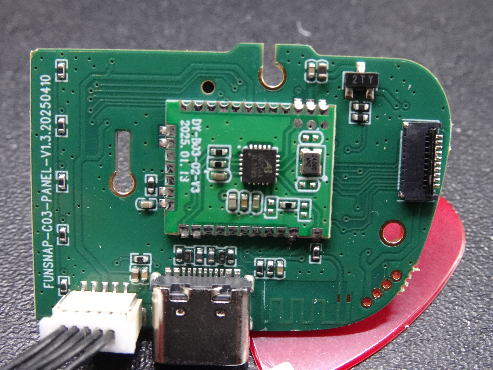
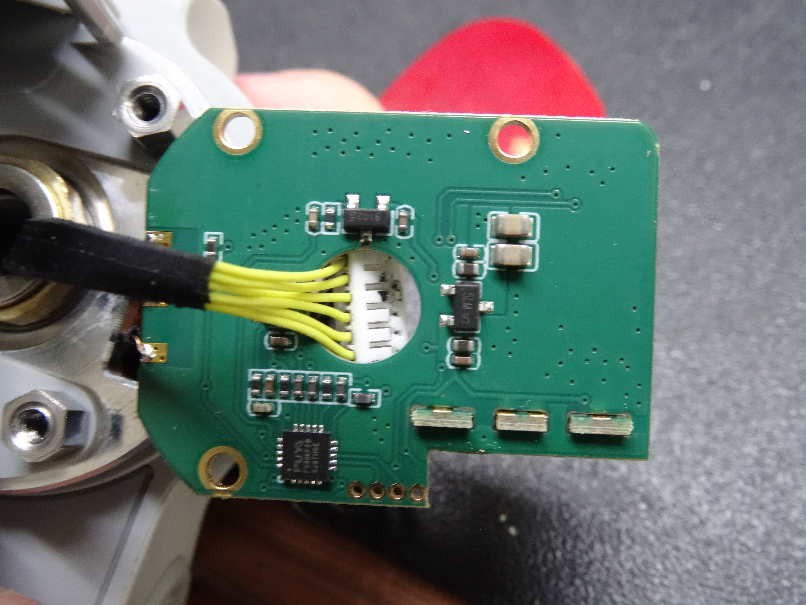
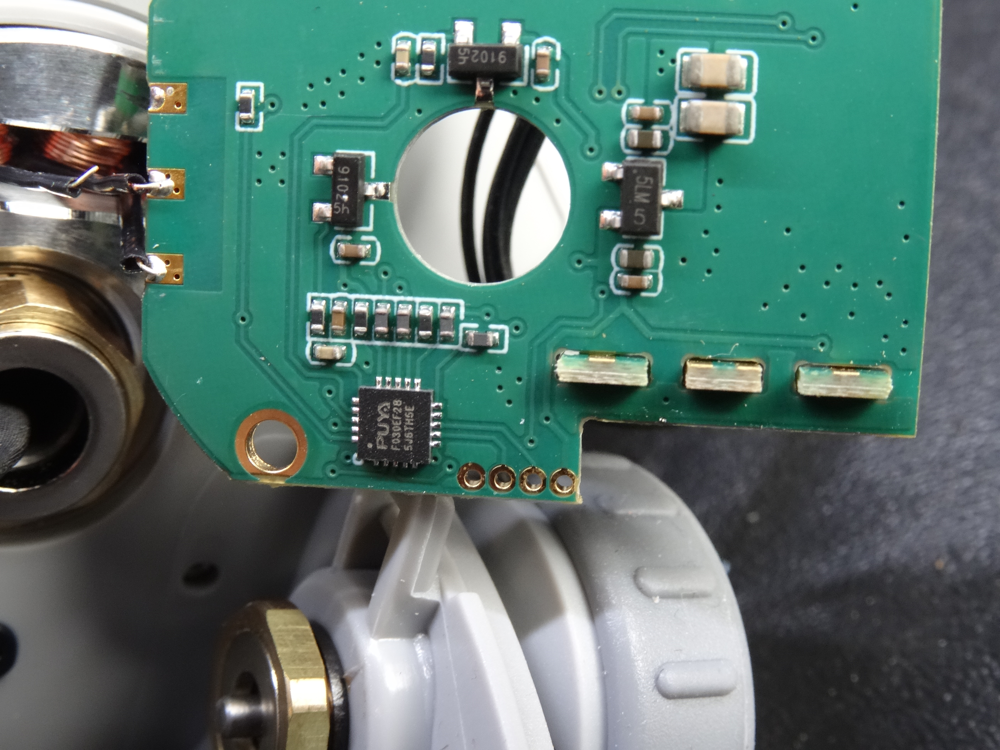
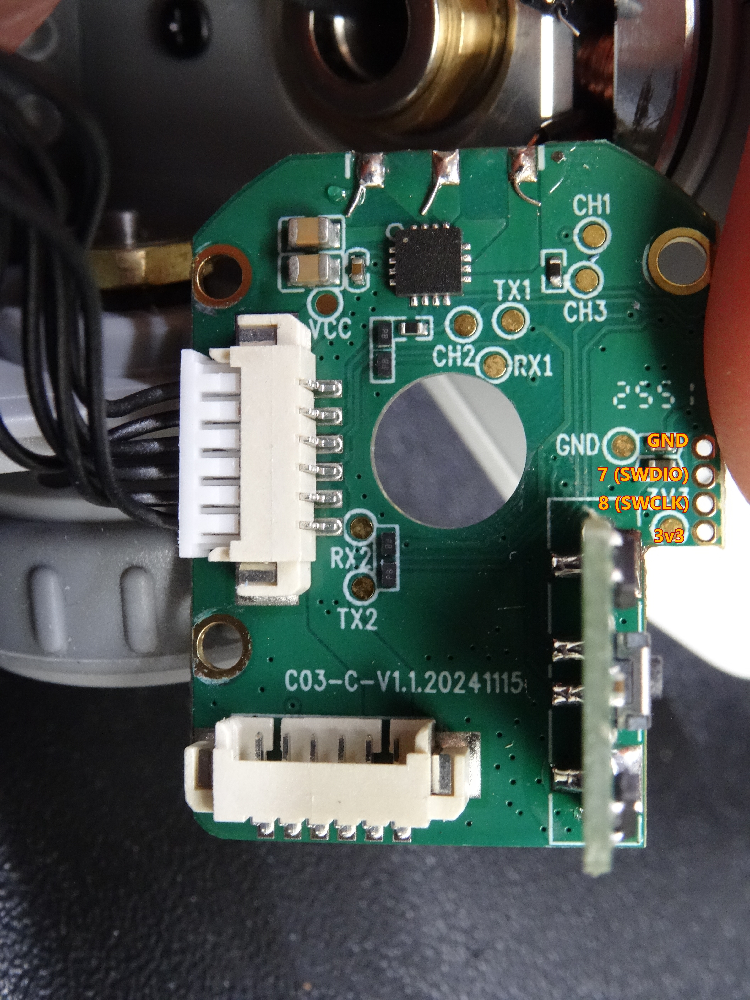
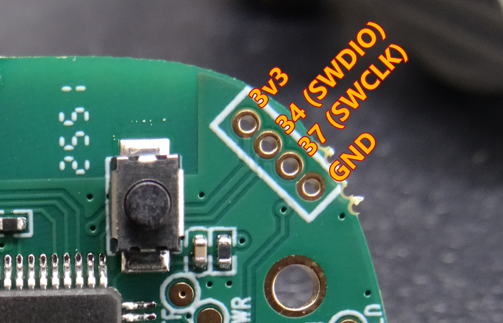
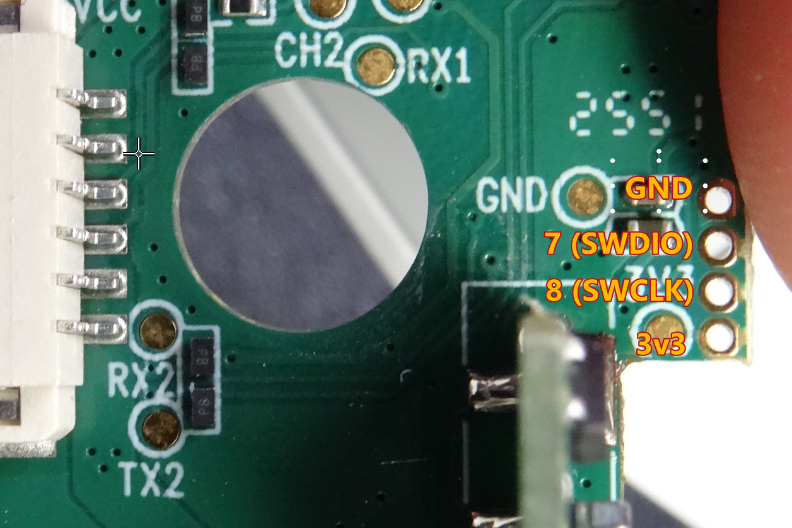

# Owner photographs

All six photographs were supplied by the owner during the investigation on 10 November 2026. The archived JPEGs preserve the original camera-file bytes. Descriptive names make board views easier to find. Original filenames and SHA-256 values are recorded in [sources.json](../sources.json).

| View | Original filename | Image |
| --- | --- | --- |
| Panel, BLE overview | `DSC02774.JPG` | [Full resolution](panel/panel-ble-overview.jpg) |
| Panel, MCU and controls | `DSC02775.JPG` | [Full resolution](panel/panel-mcu-front.jpg) |
| Panel, BLE close-up | `DSC02776.JPG` | [Full resolution](panel/panel-ble-closeup.jpg) |
| Motor board overview | `DSC02777.JPG` | [Full resolution](motor/motor-overview.jpg) |
| Motor MCU close-up | `DSC02778.JPG` | [Full resolution](motor/motor-mcu-closeup.jpg) |
| Motor connectors and opposite side | `DSC02779.JPG` | [Full resolution](motor/motor-connector-side.jpg) |

## Panel overview

## Panel MCU

## Panel BLE module

## Motor overview

## Motor MCU

## Motor connectors

## Measured SWD headers

The annotated owner images show the final corrected pad mappings. Read their orientation against the board features, because the pad order differs between boards. [Pin tables and measurement scope](../docs/hardware.md)

